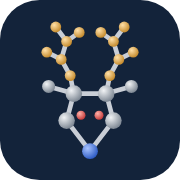

# ShikaMol

ブラウザで動く分子ビューアです。

[English](README.md) | **日本語**

PDB ID かファイルを読み込むだけで、構造の表示、電子密度・クライオ電顕マップの重ね合わせ、残基どうしの相互作用の解析、論文用の高解像度画像の書き出しまでを一つの画面で行えます。インストールは要りません。パソコン・iPad・スマートフォンのブラウザで動きます。

**▶ 使ってみる：https://strb-sho7.github.io/shikamol/**

---

## 使い方

1. 上のアドレスを開きます。
2. 左の「構造」タブで、PDB ID（例 `7DA1`。`pdb_00007da1` のような 12 文字の形でも可）を入力して「読込」を押します。`7DA1 1D66 3PQR` のようにスペースかカンマで区切ると、複数の構造をまとめて読み込めます。UniProt ID（例 `P04637`）を入れると、AlphaFold Database の予測構造を読み込みます。手元の `.pdb` / `.cif` ファイルを読み込むこともできます（ドラッグ＆ドロップ可）。
3. 分子ウィンドウで残基をクリック（タブレットではタップ）すると、その残基にズームし、周囲 5 Å 以内の相互作用が点線で表示され、一覧は画面下の「相互作用」タブに出ます（「配列」タブと切り替え）。背景をクリックすると解除され、背景をダブルクリック（タブレットではダブルタップ）すると全体表示と奥行きの見え方が元に戻ります。

### アドレスで構造を指定する

アドレスの末尾に `?pdb=` を付けると、開いたときにその構造を読み込みます。授業で「今日の構造」を配るときに便利です。

```
https://strb-sho7.github.io/shikamol/?pdb=7DA1
https://strb-sho7.github.io/shikamol/?pdb=AF-P04637
```

AlphaFold の予測構造は `AF-` に続けて UniProt ID を書きます。

### 今の表示をリンクで共有する

「表示・出力」タブの「⑤ 保存と共有」→「🔗 今の表示をリンクで共有」を押すと、今の画面を再現するリンクができます。リンクを開いた人は、同じ構造・色・表示形式・選んでいる残基・視点から始められます。PDB ID と UniProt ID で開いた構造が対象です（手元のファイルはリンクに入らないので、セッションの `.json` を渡してください）。

## 主な機能

**表示**
- Chain ごとの色分け、構造ごとの単色、N末→C末（紫→緑→黄）の色分け
- 表示形式（カートゥーン・スティック・表面など）の切り替え、カートゥーンの透明度
- 見た目：質感（標準・マット・フラット・淡い）、輪郭線、奥のぼかし、「イラスト風」「淡い色調」のまとめて設定
- クリックした残基のスティック：タンパク質は「主鎖＋側鎖／側鎖のみ」、核酸は「全体／骨格のみ／塩基のみ」から選択（相互作用している原子は常に表示）
- 残基ラベル：解析用（残基の上に固定）と図用（ドラッグで動かせる・重ならないように自動配置）。文字色は白・黒か Chain の色を選択
- 表面の色分け：疎水性、保存度、APBS の静電ポテンシャル（`.dx` を読み込み）
- 配列の帯：画面下に配列を表示し、クリックやドラッグで残基を選択
- 選択の保存：選んだ残基に名前・色・表示形式を付けて残し、表示を切り替え
- 範囲選択：分子ウィンドウ上をドラッグして、四角で囲んだ残基を選択
- 周りを薄くする表示：注目している残基から一定の距離より外側を薄くする
- 対称分子：結晶構造の対称分子を表示し、選んだものを Chain として加えて解析
- 生物学的集合体：RCSB に登録された集合体の座標を読み込み
- 複数の構造の読み込みと重ね合わせ（自動・配列アライメント・構造ベース・残基番号から選択。配列の似ていないホモログも構造で重ね合わせ可能）
- 構造ごとに選択を残す：別の構造の残基をクリックしても前の構造のスティックと相互作用が残り、番号の違う構造どうしでも好きな残基を並べて比較
- 連動表示：選んだ残基と同じ Chain 名・残基番号の残基を、ほかの構造でもスティック表示し、相互作用も構造ごとに計算（アポ型とホロ型、変異体などの比較）

**電子密度・マップ**
- X 線結晶構造：PDBe の密度サーバーから 2mFo-DFc / mFo-DFc マップを取得し、クリックした残基の周りに球状の範囲で表示
- クライオ電顕構造：EMDB のマップを、登録された推奨の等高線レベルで表示
- 手元のマップファイル（`.ccp4` / `.map` / `.mrc` など）の読み込み
- 精密化の MTZ ファイル（Phenix の 2FOFCWT / FOFCWT、Refmac の FWT / DELFWT など）から、ブラウザの中で 2Fo-Fc / Fo-Fc マップを計算（PDB ID のない未発表の構造でも使えます）
- マップは構造ごとにまとめて表示し、折りたたみ可能

**解析**
- クリックした残基の相互作用の一覧：水素結合、塩橋、疎水性相互作用、π スタッキング、カチオン–π、金属配位、ハロゲン結合、水を介した水素結合
  - 種類ごとの表示・非表示、主鎖どうしの相互作用の表示・非表示
  - 疎水性相互作用は、接している炭素の向かい合う側に細かい灰色のドットで表示（点線にも切り替え可能）
  - 範囲：クリックした残基に関わるものだけ、または表示中の 5 Å 以内の残基どうしすべて
  - 距離の判定基準は「解析」タブで変更可能（水素結合の初期値はドナー–アクセプター間 3.5 Å、硫黄が関わる場合は +0.6 Å）
- Chain 間の界面の解析：界面の残基の組、埋没表面積（BSA）、界面面積
- 保存度（ConSurf 風）：多重配列アラインメント（MSA）から計算するか、ConSurf の結果ファイルを読み込んで色分け
- 変異の位置：変異のリスト（R51A、p.Arg51Ala など）を貼り付けると、構造の上に位置を表示
  - 元の残基が構造と合うかを確かめ、番号がずれていれば正しいずれを提案
  - それぞれの位置の埋もれ具合・二次構造・保存度・相互作用を一覧にし、構造から分かる注意点（埋もれた位置への電荷の持ち込み、ヘリックス中の Pro、ジスルフィド結合や塩橋の切断など）を表示
  - グループ名を付けると色分け。各行に数値（FoldX などの ΔΔG、活性の値）を書くと、その値で青–白–赤に色分け
  - UniProt の番号で入力可能（PDB ID で開いた構造は PDBe の SIFTS で変換、AlphaFold の予測構造はそのまま）
  - 表のコピー、セッション保存、共有リンクに対応
- AlphaFold の予測構造：UniProt ID で読み込み、予測の信頼度（pLDDT）を AlphaFold Database と同じ4段階の色で表示（構造ごとに、Chain の表の「一括」の色ボタンで切り替え。全構造まとめては「構造」タブ上の「全構造」の色の欄）

**出力**
- 測定：分子ウィンドウ右上の「📏 測定」を押し、原子をタップして距離・角度・二面角を測定
  - 測った値は分子ウィンドウの一覧に並び、1件ずつ、またはまとめて「隠す」「消す」が可能（隠した測定は画像にも出ない）
  - 一覧のコピー、セッション保存、画像への書き出しに対応
- スケールバー（Å）の表示
- 分子の寸法（最大径と主軸方向の長さ）：「表示・出力」タブで、構造全体か Chain を選んで表示（「表示しない」で消える）
- 論文用の PNG 書き出し：幅（mm / inch / px）と解像度（dpi）を指定して、600 dpi 以上でも書き出し可能（ラベルも含めて書き出し）
- 相互作用の一覧のコピー（表計算ソフトに貼り付け可能）
- セッションの保存・読み込み：表示や解析の状態を `.json` ファイルに保存
- 共有リンク：今の表示（構造・色・表示形式・選択・視点・見た目）をリンク1本で共有

**使いやすさ**
- 1つ前に戻す・やり直す（分子ウィンドウ右上の「↶ 戻す」「↷」、または Ctrl／⌘＋Z、Ctrl／⌘＋Shift＋Z）
- 作業状態の自動保存：次に開いたときに「前回の作業を復元」できます（保存先はブラウザの中だけ）
- 誤操作の防止：スマートフォンやタブレットで「戻る」やスワイプをしても、1回目はページを離れません
- 日本語 / English の切り替え

## データの扱い

- 手元から読み込んだファイル（構造・マップ・MTZ・MSA など）は、すべてブラウザの中だけで処理されます。どこにも送信されません。未発表の構造も安心して使えます。
- 自動保存の内容は、使っている端末のブラウザの中（IndexedDB）にだけ保存されます。
- PDB ID から読み込むときは、RCSB PDB・PDBe・EMDB の公開データを取得します。

## iPad・タブレットで使うとき

- タップで残基の選択、背景のタップで解除、1 本指のドラッグで回転、2 本指でズームと移動ができます。
- 配列の帯は、長押ししてからなぞると範囲を選べます。
- ダウンロードしたファイルの名前が `1abc.pdb.txt` のようになっていても、そのまま読み込めます。
- Safari の共有ボタン →「ホーム画面に追加」で、鹿のアイコンからアプリのように全画面で起動できます（画面端のスワイプで戻ってしまうこともなくなります）。

## 動作環境

Chrome、Edge、Safari、Firefox の最新版。WebGL が使えるブラウザが必要です。

index.html だけをダウンロードして開いた場合は、同じフォルダに ngl.js がないため、NGL をインターネット（unpkg）から読み込みます。

## 使っているライブラリ・データ・計算方法

**ライブラリ**
- NGL Viewer 2.3.1（MIT ライセンス）。ShikaMol と同じ場所に置いた `ngl.js` を読み込みます（npm パッケージ ngl 2.3.1 の `dist/ngl.js` を改変せずに同梱）。`ngl.js` に含まれる three.js・Mol\*・chroma.js・sprintf-js・JS-Signals を含め、ライセンス文は [THIRD_PARTY_LICENSES.txt](THIRD_PARTY_LICENSES.txt) にまとめています。
  - Rose AS, Hildebrand PW. NGL Viewer: a web application for molecular visualization. *Nucleic Acids Res.* 2015;43:W576–W579. doi:[10.1093/nar/gkv402](https://doi.org/10.1093/nar/gkv402)
  - Rose AS, et al. NGL viewer: web-based molecular graphics for large complexes. *Bioinformatics.* 2018;34:3755–3758. doi:[10.1093/bioinformatics/bty419](https://doi.org/10.1093/bioinformatics/bty419)

**データ**
- RCSB PDB（座標、エントリー情報、生物学的集合体）
- PDBe の密度サーバー（X 線結晶構造の電子密度）
- EMDB（クライオ電顕マップと推奨の等高線レベル）
- AlphaFold Database（予測構造。データは CC BY 4.0。使ったときは次の論文を引用してください）
  - Varadi M, et al. AlphaFold Protein Structure Database in 2024: providing structure coverage for over 214 million protein sequences. *Nucleic Acids Res.* 2024;52:D368–D375. doi:[10.1093/nar/gkad1011](https://doi.org/10.1093/nar/gkad1011)
- PDBe の SIFTS（PDB と UniProt の残基番号の対応。変異の位置を UniProt の番号で入れたとき）

**計算方法**
- 相互作用の種類と判定基準は、PLIP と Mol* を参考にしています。
  - Salentin S, et al. PLIP: fully automated protein–ligand interaction profiler. *Nucleic Acids Res.* 2015;43:W443–W447. doi:[10.1093/nar/gkv315](https://doi.org/10.1093/nar/gkv315)
  - Sehnal D, et al. Mol* Viewer: modern web app for 3D visualization and analysis of large biomolecular structures. *Nucleic Acids Res.* 2021;49:W431–W437. doi:[10.1093/nar/gkab314](https://doi.org/10.1093/nar/gkab314)
- S–S 結合：ファイルに記録（mmCIF の struct_conn、PDB の CONECT）があればそれを使い、記録のない Cys の SG どうしが 2.5 Å 以内にあるときは距離から結合を追加します（追加したときは画面に表示）。
- 重ね合わせ：Cα を BLOSUM62 とアフィンギャップ（開始 −10、延長 −0.5）の配列アライメントで対応付け、配列一致度が 30% 未満のときなどは TM-score を用いた構造ベースの対応付けに切り替えます。回転は四元数による最小二乗解（Horn の方法）で求め、RMSD の 2 倍を超える外れ値を除いて最大 5 回当てはめ直します。
  - Henikoff S, Henikoff JG. Amino acid substitution matrices from protein blocks. *Proc. Natl. Acad. Sci. USA* 1992;89:10915–10919. doi:[10.1073/pnas.89.22.10915](https://doi.org/10.1073/pnas.89.22.10915)
  - Gotoh O. An improved algorithm for matching biological sequences. *J. Mol. Biol.* 1982;162:705–708. doi:[10.1016/0022-2836(82)90398-9](https://doi.org/10.1016/0022-2836(82)90398-9)
  - Horn BKP. Closed-form solution of absolute orientation using unit quaternions. *J. Opt. Soc. Am. A* 1987;4:629–642. doi:[10.1364/JOSAA.4.000629](https://doi.org/10.1364/JOSAA.4.000629)
  - Zhang Y, Skolnick J. Scoring function for automated assessment of protein structure template quality. *Proteins* 2004;57:702–710. doi:[10.1002/prot.20264](https://doi.org/10.1002/prot.20264)
  - Zhang Y, Skolnick J. TM-align: a protein structure alignment algorithm based on the TM-score. *Nucleic Acids Res.* 2005;33:2302–2309. doi:[10.1093/nar/gki524](https://doi.org/10.1093/nar/gki524)
- 界面面積は PISA と同じ定義（埋没表面積の合計の 1/2）です。
  - Krissinel E, Henrick K. Inference of macromolecular assemblies from crystalline state. *J. Mol. Biol.* 2007;372:774–797. doi:[10.1016/j.jmb.2007.05.022](https://doi.org/10.1016/j.jmb.2007.05.022)
- 保存度は Jensen–Shannon divergence で計算し、ConSurf と同じ 9 段階に分けて色分けしています。
  - Capra JA, Singh M. Predicting functionally important residues from sequence conservation. *Bioinformatics.* 2007;23:1875–1882. doi:[10.1093/bioinformatics/btm270](https://doi.org/10.1093/bioinformatics/btm270)
- 変異の位置の埋もれ具合は、溶媒露出表面積を Gly-X-Gly での最大値（理論値）で割った相対値です。注意点の項目は Missense3D が使っている構造の特徴を参考にしています（安定性の変化 ΔΔG の予測ではありません）。側鎖の大きさの変化には残基の体積を使っています。
  - Tien MZ, Meyer AG, Sydykova DK, Spielman SJ, Wilke CO. Maximum allowed solvent accessibilites of residues in proteins. *PLoS ONE* 2013;8:e80635. doi:[10.1371/journal.pone.0080635](https://doi.org/10.1371/journal.pone.0080635)
  - Ittisoponpisan S, Islam SA, Khanna T, Alhuzimi E, David A, Sternberg MJE. Can predicted protein 3D structures provide reliable insights into whether missense variants are disease associated? *J. Mol. Biol.* 2019;431:2197–2212. doi:[10.1016/j.jmb.2019.04.009](https://doi.org/10.1016/j.jmb.2019.04.009)
  - Zamyatnin AA. Protein volume in solution. *Prog. Biophys. Mol. Biol.* 1972;24:107–123. doi:[10.1016/0079-6107(72)90005-3](https://doi.org/10.1016/0079-6107(72)90005-3)

## 作者

伊藤 翔（奈良先端科学技術大学院大学）

不具合の報告や要望は、このリポジトリの「Issues」からお願いします。
