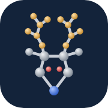

# ShikaMol

A molecular viewer that runs in your browser.

**English** | [日本語](README.ja.md)

Load a PDB ID or a file, and you can display the structure, overlay electron density or cryo-EM maps, analyse interactions between residues, and export high-resolution images for papers — all on one screen. No installation is needed. It works in browsers on computers, iPads and smartphones.

**▶ Open the viewer: https://strb-sho7.github.io/shikamol/**

---

## Getting started

1. Open the address above.
2. In the "Structure" tab on the left, type a PDB ID (e.g. `7DA1`; the 12-character form such as `pdb_00007da1` also works) and press "Load". You can also load a local `.pdb` / `.cif` file (drag and drop works too).
3. Click a residue in the viewer (tap on a tablet). The view zooms to it, and interactions within 5 Å are shown as a list and as dashed lines. Click the background to clear.

The interface is in Japanese by default; switch to English with the language menu (日本語 / English) at the top of the left panel.

### Choosing a structure in the address

Add `?pdb=` to the end of the address to load that structure when the page opens. This is handy for handing out "today's structure" in a class.

```
https://strb-sho7.github.io/shikamol/?pdb=7DA1
```

### Sharing the current view as a link

In the "Display & export" tab, open "⑤ Save & share" and press "🔗 Share this view as a link". The link reproduces the current screen: whoever opens it starts from the same structure, colours, representations, selected residues and viewpoint. It covers structures opened by PDB ID (local files are not included; send the session `.json` instead).

## Features

**Display**
- Colouring by chain, one colour per structure, or N- to C-terminus (purple → green → yellow)
- Cartoon, sticks, surface and other representations; adjustable cartoon transparency
- Look: material (standard, matte, flat, soft), outlines, depth fade, and one-click "illustration" and "soft colours" presets
- Sticks for clicked residues: proteins as "main + side chain" or "side chain only"; nucleic acids as "whole", "backbone only" or "base only" (atoms taking part in interactions are always shown)
- Residue labels: analysis mode (fixed on the residues) and figure mode (draggable, auto-arranged so they do not overlap)
- Surface colouring by hydrophobicity, conservation, or APBS electrostatic potential (load a `.dx` file)
- Sequence strip: the sequence is shown at the bottom of the screen; click or drag to select residues
- Saved selections: keep selected residues under a name, with their own colour and representation, and toggle them on and off
- Box selection: drag a rectangle in the viewer to select the residues inside it
- Spotlight: fade everything farther than a set distance from the residues of interest
- Symmetry mates: show symmetry copies in crystal structures, and add selected copies as chains for analysis
- Biological assemblies: load the assembly coordinates registered at RCSB
- Load and superpose multiple structures

**Electron density and maps**
- X-ray structures: 2mFo-DFc / mFo-DFc maps from the PDBe density server, shown in a sphere around the clicked residue
- Cryo-EM structures: EMDB maps at the recommended contour level registered with the entry
- Local map files (`.ccp4` / `.map` / `.mrc`, etc.)
- 2Fo-Fc / Fo-Fc maps computed in the browser from refinement MTZ files (e.g. Phenix 2FOFCWT / FOFCWT, Refmac FWT / DELFWT), also for unpublished structures without a PDB ID
- Maps are grouped by structure in collapsible lists

**Analysis**
- Interaction list for the clicked residue: hydrogen bonds, salt bridges, hydrophobic contacts, π-stacking, cation–π, metal coordination, halogen bonds, and water-mediated hydrogen bonds
  - Show or hide each interaction type, and backbone–backbone interactions
  - Hydrophobic contacts are drawn as fine grey dots on the facing sides of the two carbons (dashed lines are also available)
  - Scope: only interactions of the clicked residue, or all interactions among the residues shown within 5 Å
  - Distance criteria can be changed in the "Analysis" tab (default hydrogen-bond limit: 3.5 Å donor–acceptor, +0.6 Å when sulfur is involved)
- Interface analysis between chains: residue pairs at the interface, buried surface area (BSA), and interface area
- Conservation (ConSurf-style): calculate from a multiple sequence alignment (MSA), or load a ConSurf result file

**Output**
- PNG export for papers: set the width (mm / inch / px) and resolution (dpi); 600 dpi and above is supported (labels included)
- Copy the interaction list (paste into a spreadsheet)
- Save and open sessions: the display and analysis state is saved as a `.json` file
- Share links: the current view (structures, colours, representations, selection, viewpoint, look) in a single link

**Convenience**
- Undo and redo ("↶" and "↷" at the top right of the viewer, or Ctrl/⌘+Z and Ctrl/⌘+Shift+Z)
- Automatic saving of your work: when you open the viewer again, you can restore the previous session (kept only in your browser)
- Protection against accidental "back": on phones and tablets, the first back button press or swipe does not leave the page
- Japanese / English interface

## Your data

- Files you load from your computer (structures, maps, MTZ, MSAs, etc.) are processed only inside your browser. They are never sent anywhere, so unpublished structures are safe to use.
- When you load by PDB ID, public data are fetched from RCSB PDB, PDBe and EMDB.
- Automatically saved work is stored only in your own browser (IndexedDB).

## On iPads and tablets

- Tap a residue to select it, tap the background to clear, drag with one finger to rotate, and use two fingers to zoom and move.
- On the sequence strip, press and hold, then slide to select a range.
- Files saved with names such as `1abc.pdb.txt` load as they are.
- In Safari, use the Share button → "Add to Home Screen" to start the viewer full-screen from the deer icon, like an app (edge swipes no longer go back).

## Requirements

Recent versions of Chrome, Edge, Safari or Firefox. A browser with WebGL is required.

If index.html is downloaded and opened on its own, without ngl.js in the same folder, NGL is loaded from the internet (unpkg).

## Libraries, data and methods

**Library**
- NGL Viewer 2.3.1 (MIT licence). ShikaMol loads `ngl.js` from the same folder (the unmodified `dist/ngl.js` of the npm package ngl 2.3.1). Licence texts, including those of three.js, Mol\*, chroma.js, sprintf-js and JS-Signals contained in `ngl.js`, are in [THIRD_PARTY_LICENSES.txt](THIRD_PARTY_LICENSES.txt).
  - Rose AS, Hildebrand PW. NGL Viewer: a web application for molecular visualization. *Nucleic Acids Res.* 2015;43:W576–W579. doi:[10.1093/nar/gkv402](https://doi.org/10.1093/nar/gkv402)
  - Rose AS, et al. NGL viewer: web-based molecular graphics for large complexes. *Bioinformatics.* 2018;34:3755–3758. doi:[10.1093/bioinformatics/bty419](https://doi.org/10.1093/bioinformatics/bty419)

**Data**
- RCSB PDB (coordinates, entry information, biological assemblies)
- PDBe density server (electron density for X-ray structures)
- EMDB (cryo-EM maps and recommended contour levels)

**Methods**
- Interaction types and criteria follow PLIP and Mol*.
  - Salentin S, et al. PLIP: fully automated protein–ligand interaction profiler. *Nucleic Acids Res.* 2015;43:W443–W447. doi:[10.1093/nar/gkv315](https://doi.org/10.1093/nar/gkv315)
  - Sehnal D, et al. Mol* Viewer: modern web app for 3D visualization and analysis of large biomolecular structures. *Nucleic Acids Res.* 2021;49:W431–W437. doi:[10.1093/nar/gkab314](https://doi.org/10.1093/nar/gkab314)
- Interface area uses the same definition as PISA (half of the total buried surface area).
  - Krissinel E, Henrick K. Inference of macromolecular assemblies from crystalline state. *J. Mol. Biol.* 2007;372:774–797. doi:[10.1016/j.jmb.2007.05.022](https://doi.org/10.1016/j.jmb.2007.05.022)
- Conservation is calculated as Jensen–Shannon divergence and coloured in the same nine grades as ConSurf.
  - Capra JA, Singh M. Predicting functionally important residues from sequence conservation. *Bioinformatics.* 2007;23:1875–1882. doi:[10.1093/bioinformatics/btm270](https://doi.org/10.1093/bioinformatics/btm270)

## Author

Sho Ito (Nara Institute of Science and Technology)

Please report bugs or send requests through "Issues" in this repository.
